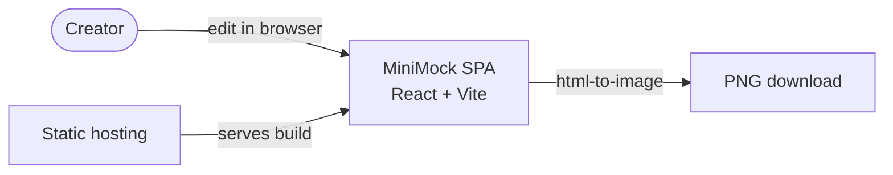
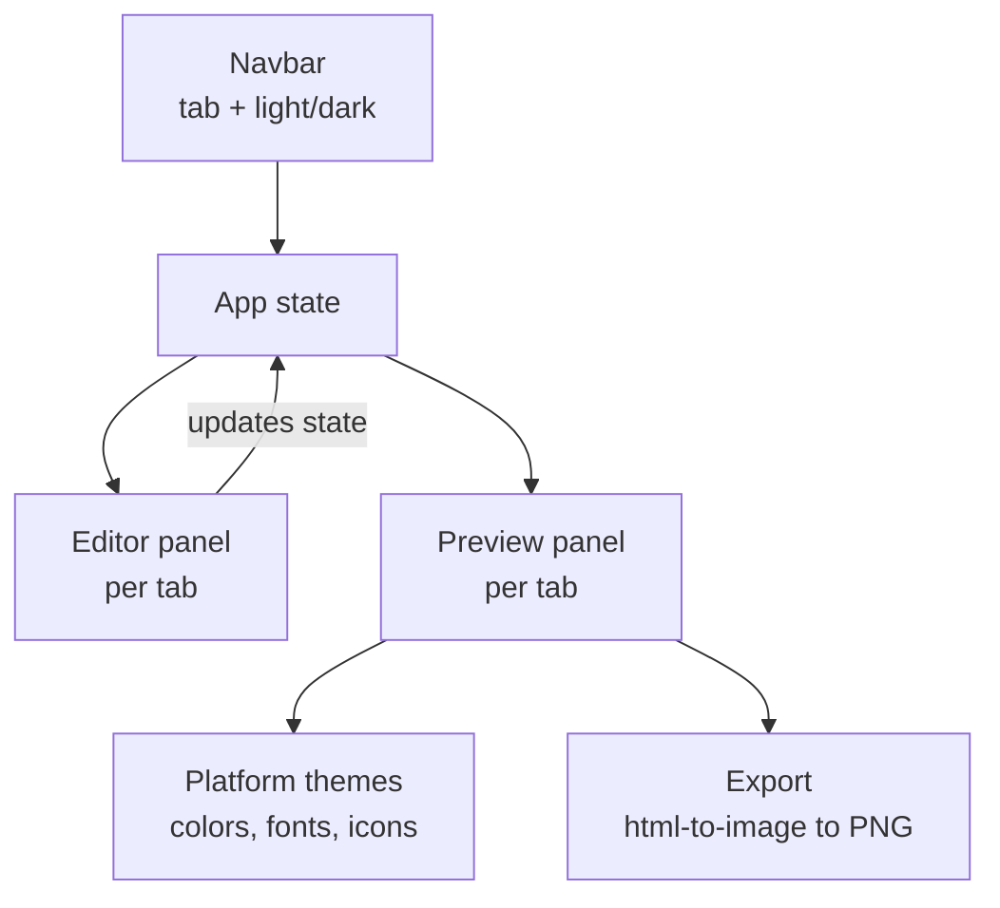

# MiniMock: High-Level Design

Create realistic chat, AI-chat, story, post, comment and email mockups in the browser and export them as PNG. No sign-up, no watermark, and nothing is saved on a server. Live at [mock.minianon.in](https://mock.minianon.in). For code-level detail see the [Low-Level Design](lld.md).

## 1. System context

MiniMock is fully client-side. There is no backend, database or analytics of user content: all state lives in React memory and disappears when the tab closes.

## 2. Mockup types

| Tab | Platforms | What you edit |
|---|---|---|
| Chat | WhatsApp, Instagram, Discord, X, Microsoft Teams, Slack, Snapchat, Telegram, Reddit, LinkedIn | DM or group, people, avatars, messages, images, read status, time |
| AI chat | ChatGPT, Claude, Gemini, Grok, Perplexity (with model variants) | Prompts and responses with Markdown |
| Stories | Instagram, WhatsApp | Profile, multiple slides, active slide |
| Posts | LinkedIn, X, Instagram, Facebook, Threads, Pinterest | Author, content, image, metrics |
| Comments | LinkedIn, X, Instagram, Facebook, Threads, Reddit, YouTube | Creator, commenters, comment threads |
| Email | Mail client thread | Subject, participants, thread, attachment |

## 3. Components

| Component | Responsibility |
|---|---|
| App shell | Holds every tab's state, resizable editor width, mobile edit / preview toggle |
| Editors | Forms for people, messages, appearance and platform per tab |
| Previews | Pixel-faithful renderings of each platform's UI, optional phone frame and status bar |
| Theme maps | `platformThemes.js` and `aiThemes.jsx` define each platform's look |
| Download modal | File name, then PNG export at 3× pixel ratio |

## 4. Tech stack

| Layer | Choice |
|---|---|
| UI | React 19 + Vite |
| Drag and drop | dnd-kit (reorder messages and items) |
| Rendering text | react-markdown + remark-gfm (AI responses) |
| Export | html-to-image (`toPng`) |
| Icons | Tabler Icons, Lucide |

## 5. Quality attributes

| Attribute | Approach |
|---|---|
| Privacy | 100% client-side; no storage, no uploads |
| Output quality | Exports at 3× pixel ratio, optional transparent background |
| Fidelity | Each platform has its own theme, header, bubble and footer components |
| Responsiveness | Desktop split view with draggable divider (280–600 px); mobile switches between edit and preview |
| Known limits | Work is lost on refresh (no saving); mockups are for design and demos, not impersonation |
