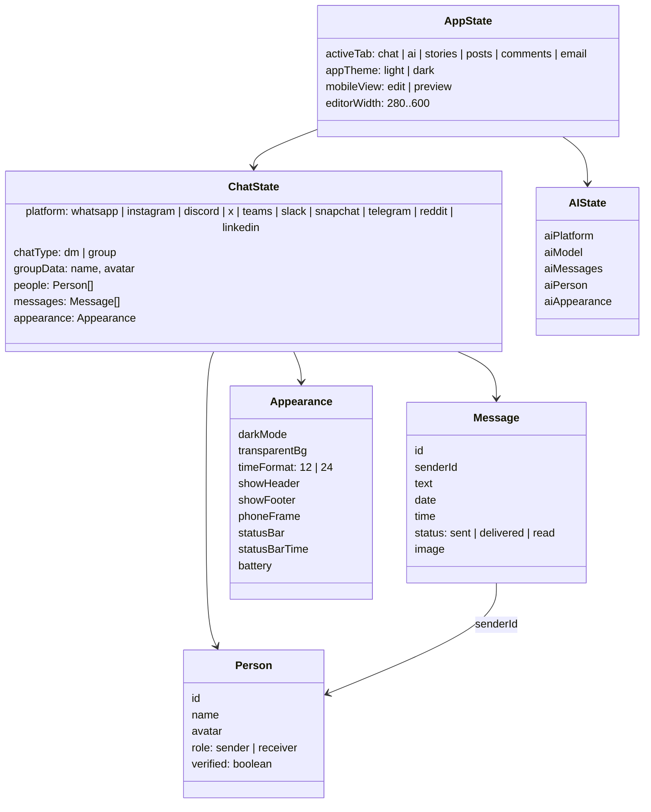
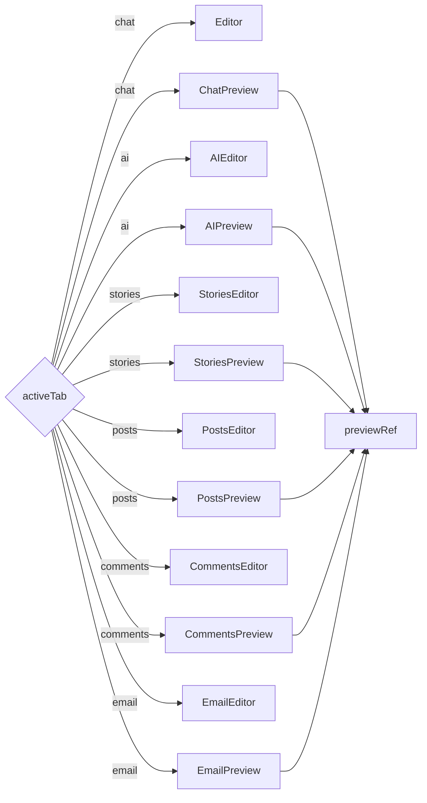
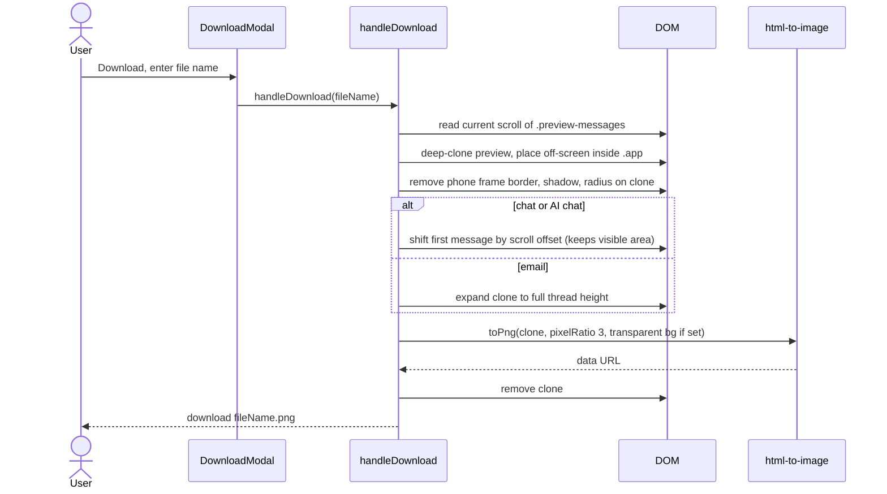

# MiniMock: Low-Level Design

State, components and the export pipeline. For the big picture see the [High-Level Design](hld.md).

## 1. Source layout

| Path | Role |
|---|---|
| `src/App.jsx` | All state, tab switching, resizable layout, PNG export |
| `src/components/Navbar.jsx` | Tab bar and app light / dark theme |
| `src/components/Editor.jsx` + `PlatformSelector`, `TypeSelector`, `PeopleSection`, `MessagesSection`, `AppearanceSection` | Chat editor |
| `src/components/ChatPreview.jsx` + `preview/` (`ChatHeader`, `ChatBubble`, `ChatFooter`, `StatusBar`) | Chat preview |
| `src/components/ai/` | AI chat editor and preview |
| `src/components/stories/`, `posts/`, `comments/`, `email/` | Editor + preview pair per tab |
| `src/components/DownloadModal.jsx` | File name prompt before export |
| `src/themes/platformThemes.js`, `src/themes/aiThemes.jsx` | Visual definitions per platform |

## 2. State model

Stories, posts, comments and email follow the same pattern: a platform, the content (slides, author + content + metrics, creator + commenters + comments, participants + thread) and an appearance object.

## 3. Render flow

Each preview is rendered into the element held by `previewRef`, which is what gets exported.

## 4. Export pipeline

Working on a clone means the live editor never flickers or changes during export, and the clone inherits the theme CSS variables because it is attached inside `.app`.

## 5. Layout behavior

| Behavior | Rule |
|---|---|
| Editor width | Dragging the divider sets width between 280 and 600 px |
| Mobile | At ≤ 768 px wide, a toggle switches between editor and preview |
| Default file name | Based on the active tab and platform |

## 6. Configuration

None. MiniMock needs no environment variables or keys.
